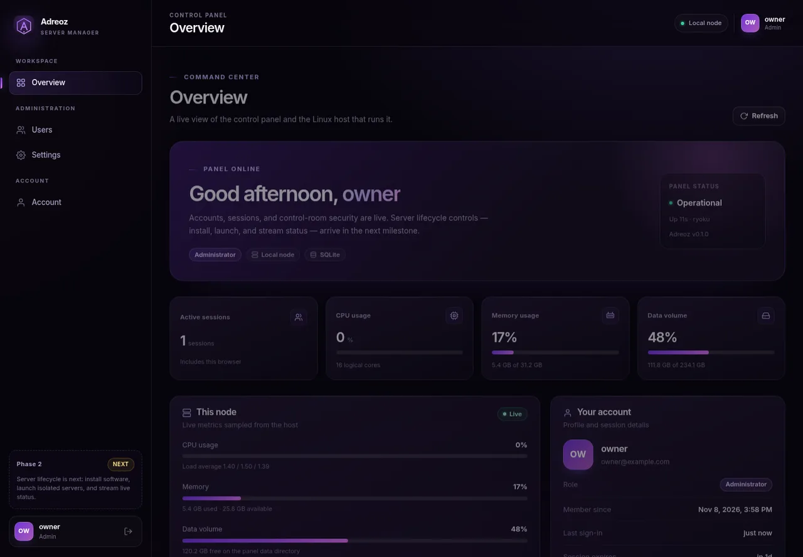

# ADREOZ SERVER MANAGER

A local-first, multi-user control panel for hosting Minecraft servers. Built to
run on a single machine you control, with a FastAPI backend, SQLite storage, and
a dependency-free vanilla JavaScript frontend.

**Phase 1 — Foundation** is complete: identity, access, and operational visibility.
**Phase 2 — Server Lifecycle** is complete: create, configure, start, and stop
Minecraft servers with per-user ownership.




---

## What works today

- **First-run setup** — creates the initial administrator, then permanently
  closes the setup endpoint.
- **Authentication** — scrypt password hashing, opaque server-side sessions,
  HttpOnly cookies, CSRF protection, host-header allowlisting, login rate
  limiting, session rotation on login, and an audit trail.
- **Role-based access control** — `admin` and `user` roles, enforced in the
  backend on every protected route. Hiding a button is never the only defence.
- **User management** — list, search, create, edit roles, disable accounts,
  reset passwords, and delete users, with last-admin and self-protection rules.
- **Dashboard** — live host CPU, memory, disk, load, host uptime, panel uptime,
  account/session details, and admin-only user and audit summaries. Every value
  comes from the machine or the database; nothing is simulated.
- **Settings** — configurable session lifetime, read-only runtime and security
  posture, admin only.
- **Account security** — change your own password, rotate the session, and
  revoke all other sessions.
- **Server lifecycle** — create, configure, start, stop, and delete Minecraft
  servers (vanilla, Paper, Fabric, Forge). Per-user ownership enforced on every
  endpoint. Server status, configuration, and process output tracked in the
  database.
- **Premium dark UI** — lavender/purple design system, responsive layout,
  accessible components, modals, toasts, and inline validation.

## Stack

| Layer | Choice |
| --- | --- |
| API | Python 3.11+ / FastAPI 0.162 |
| Data | SQLAlchemy 2.1 + Alembic + SQLite |
| Validation | Pydantic 2 |
| Frontend | Vanilla ES modules, HTML, CSS (no build step) |
| Host metrics | psutil |
| Tests | pytest + `node:test` |

## Quick start

Requirements: Linux or macOS, Python 3.11+, and optionally Node.js 18+ for the
frontend unit tests.

```bash
git clone <your-repository> "Adreoz Server Manager"
cd "Adreoz Server Manager"
./scripts/setup.sh
./scripts/run.sh
```

Open <http://127.0.0.1:8080>. The first visit shows the administrator setup
wizard. Choose a password of at least 10 characters containing a letter and a
number.

`run.sh` applies pending Alembic migrations automatically before starting
uvicorn. The process refuses to run as root.

### Manual setup

```bash
python3 -m venv .venv
.venv/bin/python -m pip install -r backend/requirements-dev.txt
ROOT="$PWD"
cd backend
"$ROOT/.venv/bin/python" -m alembic upgrade head
"$ROOT/.venv/bin/python" -m app
```

With `uv` installed, `uv pip install --python .venv/bin/python -r
backend/requirements-dev.txt` works too.

## Configuration

Configuration is read from environment variables prefixed with `ASM_`, plus an
optional `.env` in the project root. Copy `.env.example` to `.env` to begin.
All defaults are loopback-only and safe for a local install.

| Variable | Default | Purpose |
| --- | --- | --- |
| `ASM_HOST` | `127.0.0.1` | Bind address |
| `ASM_PORT` | `8080` | Bind port |
| `ASM_ENVIRONMENT` | `development` | `production` disables API docs |
| `ASM_DATA_DIR` | `<project>/data` | Database, servers, backups, logs |
| `ASM_DATABASE_URL` | `sqlite:///<data>/asm.db` | SQLAlchemy database URL |
| `ASM_SESSION_LIFETIME_HOURS` | `24` | Session lifetime seed |
| `ASM_COOKIE_SECURE` | `false` | Set `true` behind HTTPS |
| `ASM_COOKIE_SAMESITE` | `lax` | `lax` or `strict` |
| `ASM_LOGIN_ATTEMPT_LIMIT` | `10` | Attempts per window |
| `ASM_LOGIN_ATTEMPT_WINDOW_SECONDS` | `300` | Rate-limit window |
| `ASM_TRUST_PROXY_HEADERS` | `false` | Trust proxy IP headers |
| `ASM_TRUSTED_HOSTS` | `127.0.0.1,localhost,[::1]` | Allowed `Host` headers |
| `ASM_ALLOW_ROOT` | `false` | Refuse root by default |
| `ASM_LOG_LEVEL` | `info` | Uvicorn log level |

The administrator can change the *effective* session lifetime from
**Settings**; it is stored in the database and applies to sessions created
afterwards.

`ASM_TRUSTED_HOSTS` is a comma-separated allowlist. A request whose `Host`
header is not on the list is rejected with `400 Invalid host header`; add the
public hostname when running behind a reverse proxy. Runtime data directories
are created `0700`, and a file-backed SQLite database is restricted to `0600`.

## Project layout

```text
.
├── backend/
│   ├── alembic/                 # Migration environment + versions
│   ├── app/
│   │   ├── api/                 # Routes, dependencies, cookie helpers
│   │   ├── core/                # Config, security, roles, rate limiting
│   │   ├── database/            # Engine, session factory, declarative base
│   │   ├── middleware/          # Security headers and cache policy
│   │   ├── models/              # SQLAlchemy models
│   │   ├── schemas/             # Pydantic request/response models
│   │   └── services/            # Business logic and audit trail
│   ├── tests/                   # pytest suite
│   └── requirements*.txt
├── frontend/
│   ├── assets/                  # Logo
│   ├── css/                     # Tokens, base, components, layout, views
│   └── js/                      # ES-module SPA, components, views, tests
├── data/                        # Runtime database and managed files
├── deploy/                      # Example systemd unit
├── docs/                        # Architecture, security, deployment
└── scripts/                     # setup.sh, run.sh, test.sh
```

## API overview

All endpoints are JSON under `/api`, except the static frontend. Mutating
endpoints require both an authenticated session cookie **and** the
`X-CSRF-Token` header returned by setup/login/`/auth/me`.

| Method | Path | Access | Purpose |
| --- | --- | --- | --- |
| `GET` | `/api/health` | Public | Liveness probe |
| `GET` | `/api/setup/status` | Public | Whether setup is required |
| `POST` | `/api/setup` | Public, once | Create initial administrator |
| `POST` | `/api/auth/login` | Public, rate-limited | Sign in |
| `GET` | `/api/auth/me` | Session | Current user + CSRF token |
| `POST` | `/api/auth/logout` | Session + CSRF | Sign out |
| `POST` | `/api/auth/password` | Session + CSRF | Change own password |
| `DELETE` | `/api/auth/sessions` | Session + CSRF | Revoke other sessions |
| `GET` | `/api/dashboard/summary` | Session | Host/account/platform summary |
| `GET` | `/api/users` | Admin | List/search users |
| `POST` | `/api/users` | Admin + CSRF | Create user |
| `GET` | `/api/users/{id}` | Admin | Read user |
| `PATCH` | `/api/users/{id}` | Admin + CSRF | Change role/active state |
| `DELETE` | `/api/users/{id}` | Admin + CSRF | Delete user |
| `POST` | `/api/users/{id}/password` | Admin + CSRF | Reset password |
| `GET` | `/api/settings` | Admin | Read panel settings |
| `PATCH` | `/api/settings` | Admin + CSRF | Update session lifetime |
| `GET` | `/api/servers` | Session | List servers (owned or all if admin) |
| `POST` | `/api/servers` | Session + CSRF | Create a Minecraft server |
| `GET` | `/api/servers/{id}` | Session | Server details (owner or admin) |
| `PATCH` | `/api/servers/{id}` | Session + CSRF | Update server config (stopped only) |
| `DELETE` | `/api/servers/{id}` | Session + CSRF | Delete server (stopped only) |
| `POST` | `/api/servers/{id}/start` | Session + CSRF | Start server process |
| `POST` | `/api/servers/{id}/stop` | Session + CSRF | Stop server process |
| `POST` | `/api/servers/{id}/restart` | Session + CSRF | Restart server process |
| `GET` | `/api/servers/{id}/logs` | Session | Server process output |

In `development`, interactive docs are available at `/docs`. In `production`
they are disabled.

## Tests

```bash
./scripts/test.sh
```

Or run the suites individually:

```bash
# From the project root:
.venv/bin/python -m pytest backend -q
node --test frontend/js/tests/format.test.mjs
```

Current results for this phase:

- Backend: **49 passed, 1 warning** (36 Phase 1 + 13 Phase 2 server lifecycle).
- Frontend: **8 passed, 0 failed**.

The backend suite covers setup locking, login/logout, login session rotation,
CSRF enforcement, RBAC, cross-user denial, rate limiting, password change and
session rotation, deactivation and reactivation, last-admin and self
protections, delete cascades, audit logging, security headers, trusted-host
rejection, strict request bodies, owner-only file permissions, secure
cookies/HSTS, server CRUD, server ownership, server lifecycle, migrations, and
live dashboard metrics. The frontend suite covers formatting helpers used across
views.

## Security posture

- Passwords are hashed with stdlib `hashlib.scrypt`; parameters are stored in
  the hash string so they can be increased later.
- Only SHA-256 digests of session tokens are stored. Cookies are `HttpOnly`,
  `SameSite=Lax`, and path-scoped. Logging in revokes any session token already
  presented by the browser before issuing a new one.
- Every state-changing API call requires the per-session CSRF token.
- Login and setup are rate-limited per client IP.
- Request bodies reject unknown fields instead of silently ignoring them.
- A `Host` allowlist blocks DNS-rebinding and unexpected virtual hosts.
- Security headers include a strict CSP with no inline script/style,
  `frame-ancestors 'none'`, and `nosniff`; HSTS is added when cookies are
  marked `Secure`.
- Errors are normalized so passwords and raw inputs never appear in responses.
- The server binds to loopback and refuses to run as root by default. Runtime
  data directories are owner-only (`0700`) and the SQLite file is `0600`.

See [docs/security.md](docs/security.md) for the full model and its known
limitations.

## Documentation

- [Architecture](docs/architecture.md) — components, data model, request flow.
- [Security](docs/security.md) — threat model, controls, limitations.
- [Deployment](docs/deployment.md) — reverse proxy, systemd, backups, upgrades.

## Roadmap

| Phase | Scope | State |
| --- | --- | --- |
| 1 | Foundation: auth, RBAC, users, dashboard, settings | **Complete** |
| 2 | Server lifecycle: create, configure, start, stop | **Complete** |
| 3 | Console & files: WebSocket console, file manager | Next |
| 4 | Backups, schedules, and restore | Planned |
| 5 | Java/runtime management and version pinning | Planned |
| 6 | Per-server permissions and collaboration | Planned |
| 7 | Monitoring, alerts, and metrics history | Planned |
| 8 | Automation, API tokens, and integrations | Planned |

Phase 1 deliberately ships no server controls. The dashboard roadmap is
informational; it does not contain placeholder actions.

## License

No license has been chosen yet. Treat this repository as private until a
license is added.
